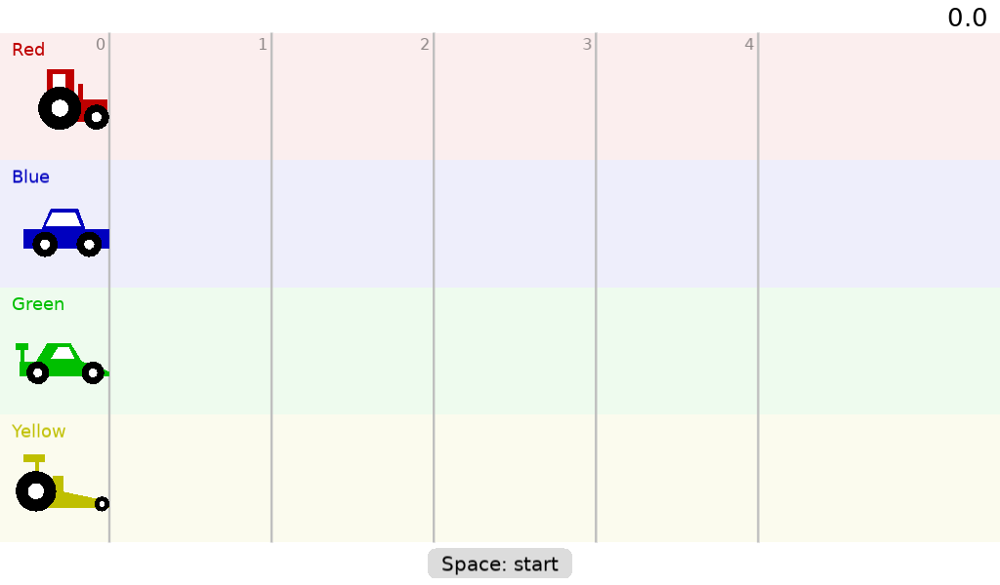
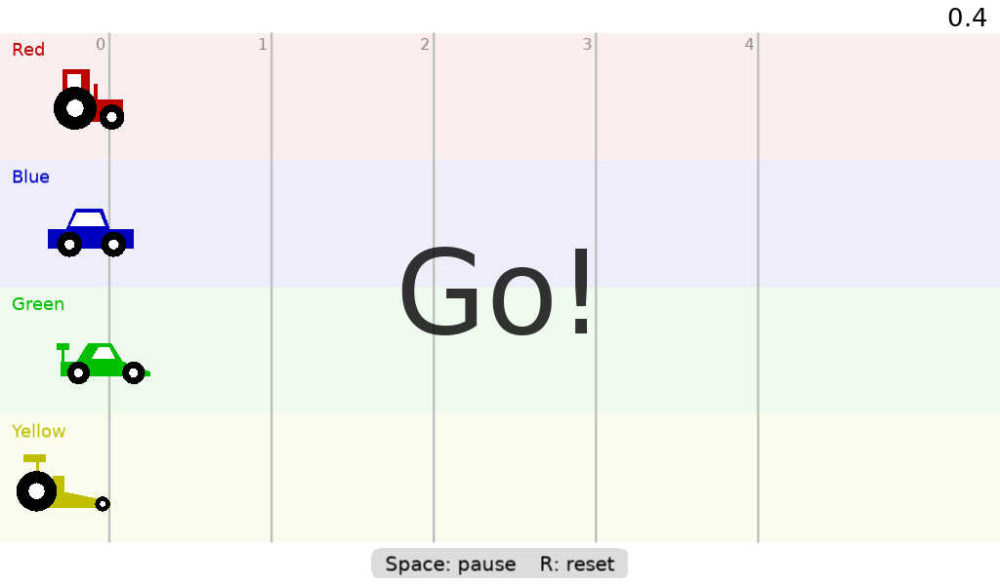
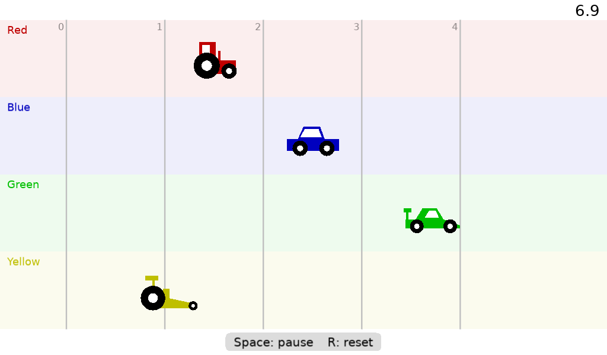
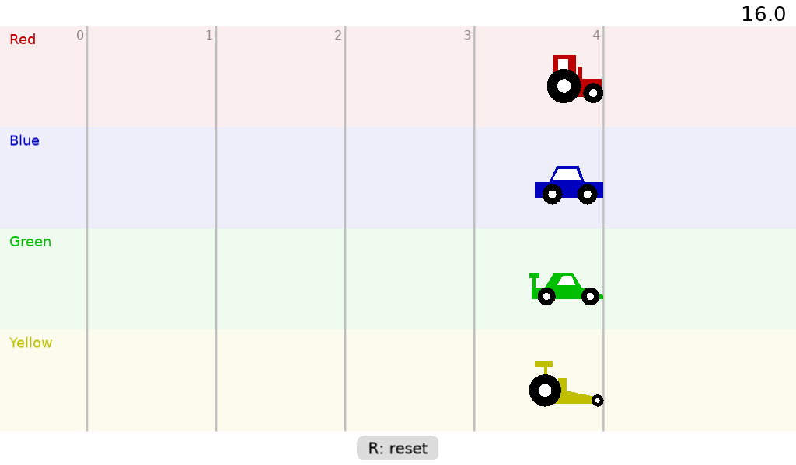
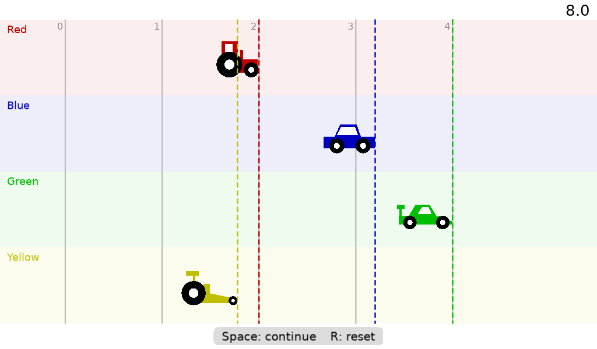
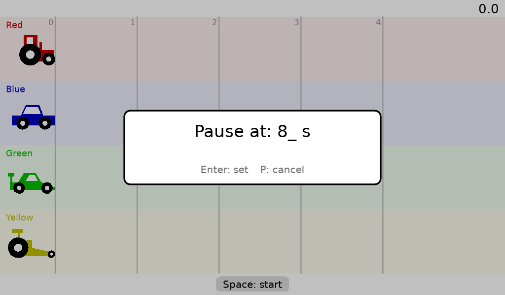

# Cars — a measurement instrument for Compy

Four cars drive along four lanes: a red tractor (constant,
slow), a blue family sedan (constant, medium), a green
sports car (constant, fast), and a yellow dragster that
starts slow and keeps accelerating. Children time each car
with a physical stopwatch as its nose crosses milestone
lines, plot the readings on paper coordinate grids, and
discover that steady cars draw straight lines while the
dragster draws a curve.

Written for the [Compy](https://github.com/compy-toys/compy/)
project. This is not a game — it is an apparatus. The screen
provides a perfectly reproducible phenomenon; the stopwatch,
pencil, and ruler are the instruments. Every run is
identical, so repeated measurements converge.

Start it from the Compy console:

```
run "cars"
```

## What happens

Press `Space`. A large 3-2-1 countdown fills the screen, a
soft knock marks **Go!**, and the cars start the instant the
word appears — the children's stopwatches and the cars share
one zero. Each time a car crosses a milestone line, a gentle
band of its color glows on the line and fades; that is the
cue to stop the stopwatch. An elapsed-time counter in the
top-right corner runs as a backup for anyone who missed a
reading.

Each car parks at the last line as it arrives, so the whole
field stays on screen while slower cars finish. When the
final car parks the run ends by itself: the counter freezes
and a soft chime tells the room the run is over.

## Milestone times

| Car    | Profile        | Line 1 | Line 2 | Line 3 | Line 4 |
|--------|----------------|--------|--------|--------|--------|
| Red    | constant, slow | 4.0 s  | 8.0 s  | 12.0 s | 16.0 s |
| Blue   | constant, med  | 2.5 s  | 5.0 s  | 7.5 s  | 10.0 s |
| Green  | constant, fast | 1.5 s  | 3.0 s  | 4.5 s  | 6.0 s  |
| Yellow | accelerating   | 6.0 s  | 8.5 s  | 10.4 s | 12.0 s |

The yellow car reaches the last line at nearly the same time
as the blue one, but distributes that time very differently —
that difference is the lesson.

## Controls

For the children:

- `Space` — start the run; pause; continue.
- `R` — reset everything to the start.

For the teacher (for the prediction rounds):

- `M` — toggle milestone line 5, placed 1.25 spacings past
  line 4, for "when will it arrive?" predictions.
- `P` — opens a prominent centered dialog; type the seconds
  and press `Enter`. A run beneath the dialog freezes while
  it is open. When the run reaches the set time it freezes,
  and dashed lines in each car's color mark the frozen
  positions for "where will it be?" predictions. `P` again
  clears the pause point. The pause point re-arms on every
  start until cleared.

Everything else is ignored. There is no score, no losing,
and nothing to break: reset or relaunch always returns to
the same initial state.

## Screenshots

Captured from a physical Compy driven over adb.

Ready to start, and the "Go!" moment — the cars are already
moving while the word lingers:




Mid-run (6.9 s) and the end of a run, every car parked at
the last line:




The teacher's fifth line, and a run frozen at 8.0 seconds
with each car's position marked — the red tractor's nose
sits exactly on line 2, as the timetable says it should:




The pause-time dialog; a run beneath it freezes while it
is open:



## Verification

Checked on a physical Compy, driven end-to-end over adb with
a virtual HID keyboard: full runs, pause/continue, resets,
bare-Esc immunity, both teacher controls, freeze-and-resume,
and exit. Two independent runs frozen at 8.0 s produced
pixel-identical frames — the reproducibility the measurement
exercise depends on. A headless Lua 5.1 harness additionally
verifies all sixteen crossing times to ±0.02 s and the full
state machine.

## License

MIT — see [LICENSE](LICENSE).
